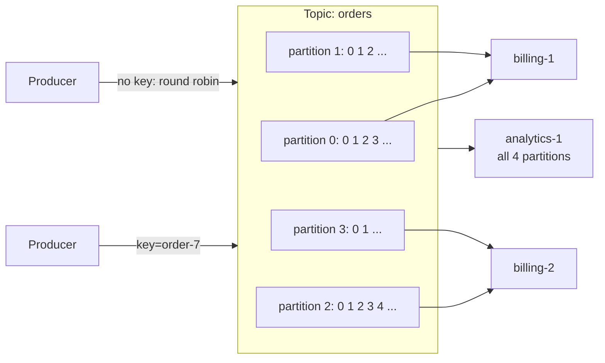

# Message Queue (Kafka-style)

A small in-memory message broker modelled on Kafka's design, in plain Java 21. I wrote it to understand what's actually happening when we configure partitions, consumer groups and offset commits on real projects.

## Features

- Topics split into **partitions**, each an append-only log with absolute offsets
- **Key-based partitioning**: same key, same partition, so per-key ordering is guaranteed
- **Consumer groups**: partitions are divided between group members; different groups each get every message (queue and pub-sub with one model)
- **Offset commits** stored per group, so a restarted consumer continues where the group left off
- **Rebalancing** when members join or leave, with generation ids that fence off "zombie" consumers
- **At-least-once delivery**: processed-but-uncommitted messages are delivered again after a rebalance
- **Long polling**: `poll(timeout)` blocks until data arrives instead of busy-looping
- **Retention**: old messages are dropped per partition; consumers that fall behind skip ahead to the earliest retained offset

## Architecture



| Package | Classes |
|---|---|
| `broker` | `Broker`, `Topic`, `PartitionLog`, `GroupCoordinator` |
| `client` | `Producer`, `Consumer` |
| root | `Message`, `TopicPartition`, `SendResult` |

## How the main pieces work

**PartitionLog** - an `ArrayList<Message>` plus `logStartOffset`. A message's offset is `logStartOffset + index`, so when retention trims the front, existing offsets don't shift. Trimming happens in 10% chunks because removing from the head of an ArrayList is O(n). Reads take a read lock, appends a write lock.

**Partition choice** - `floorMod(key.hashCode(), partitions)`. The catch, same as in Kafka: changing the partition count later changes where existing keys go and breaks ordering for them.

**GroupCoordinator** - each group has a generation number, its members' subscriptions, the current assignment and committed offsets. On every join/leave the generation goes up and partitions are dealt out round-robin. A consumer notices the new generation on its next `poll()`, drops its in-memory positions and restarts from the committed offsets.

**Fencing** - `commitSync()` sends the consumer's generation. If the group has rebalanced since, the commit is rejected; otherwise a slow consumer that lost its partitions could overwrite the offsets of the new owner (`staleMemberCannotCommitAfterRebalance`).

**Long polling** - consumers wait on a `Condition` that the broker signals on every append. The wait is sliced into 50ms pieces so an append that slips in between "fetch returned nothing" and "start waiting" isn't missed for the whole timeout.

## Delivery guarantees

| Consumer does | Result after a crash |
|---|---|
| process, then commit | at-least-once (duplicates possible) - **default here** |
| commit, then process | at-most-once (messages can be lost) |
| process + store offset in the same DB transaction | effectively exactly-once |

`uncommittedMessagesAreRedeliveredAfterRebalance` shows the at-least-once case. That's why consumers should be idempotent (e.g. dedupe on order id).

## Demo

```
Messages processed per consumer:
  analytics-consumer-3 -> 1000
  billing-consumer-2 -> 500
  billing-consumer-1 -> 500
```

Two billing instances share the load, analytics independently gets everything.

## Running

```bash
mvn test
mvn compile && java -cp target/classes com.praveen.mq.Demo
```

## Not implemented (yet)

- Persistence: segments on disk + an offset index, which is how Kafka gets sequential I/O and fast seeks
- Replication of partitions across brokers (leader/follower, in-sync replicas)
- Sticky / cooperative rebalancing, so partitions don't all move on every join
- Producer batching and acks levels
- Dead letter topic for messages that keep failing
